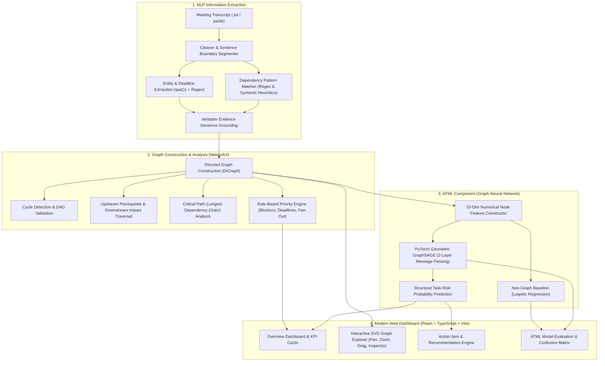

# MeetGraph — NLP-Powered Meeting Action Dependency and Risk Analysis System

MeetGraph is a full-stack, academically presentable web application that combines **Natural Language Processing (NLP)** with **Graph Representation Learning (Graph Neural Networks / GNNs)** to extract, model, and analyze task dependencies and operational risks from meeting transcripts.

Developed for university coursework in **NLP and Advanced Topics in Machine Learning (ATML)**, MeetGraph addresses the challenge of project delay cascades: identifying when an upstream bottleneck threatens downstream deliverables before deadlines are missed.

---

## 1. System Architecture



---

## 2. Core Modules & Directory Structure

```
c:\projects\nlpatml\
├── backend/
│   ├── app/
│   │   ├── api/
│   │   │   ├── __init__.py
│   │   │   └── endpoints.py          # FastAPI REST endpoints for transcripts, graph, and ML
│   │   ├── graph/
│   │   │   ├── __init__.py
│   │   │   ├── analysis.py           # Cycle detection, traversal, critical paths
│   │   │   ├── builder.py            # NetworkX graph construction & serialization
│   │   │   └── priority_engine.py    # Hybrid recommendation engine
│   │   ├── ml/
│   │   │   ├── __init__.py
│   │   │   ├── baseline_model.py     # Logistic Regression baseline on isolated node features
│   │   │   ├── dataset_generator.py  # Synthetic benchmark generator (zero graph-level leakage)
│   │   │   ├── evaluator.py          # Real-time GNN inference & evaluation loader
│   │   │   ├── gnn_model.py          # 2-layer GraphSAGE architecture
│   │   │   └── train.py              # Reproducible training script with fixed seed (42)
│   │   ├── nlp/
│   │   │   ├── __init__.py
│   │   │   ├── cleaner.py            # Normalization, sentence segmentation, speaker tags
│   │   │   ├── dependency_extraction.py # Cross-sentence dependency linking
│   │   │   ├── entity_extraction.py  # Named entity recognition, deadline normalization
│   │   │   └── pipeline.py           # End-to-end NLP coordinator
│   │   ├── database.py               # SQLite persistence layer
│   │   ├── main.py                   # FastAPI application & SPA static file serving
│   │   └── schemas.py                # Pydantic data models
│   ├── data/
│   │   └── meetgraph.db              # SQLite database (preloaded with sample meetings)
│   ├── saved_models/
│   │   ├── baseline_risk_model.pkl   # Trained non-graph baseline
│   │   ├── evaluation_results.json   # Real evaluation metrics and confusion matrices
│   │   └── gnn_risk_model.pt         # Saved PyTorch GraphSAGE weights
│   ├── tests/
│   │   ├── test_api.py               # End-to-end integration and API tests
│   │   ├── test_graph.py             # Graph traversal and cycle detection tests
│   │   ├── test_ml.py                # GNN forward pass and zero leakage tests
│   │   └── test_nlp.py               # Extraction and evidence grounding tests
│   └── requirements.txt
├── frontend/
│   ├── dist/                         # Pre-built production frontend assets
│   ├── src/
│   │   ├── components/
│   │   │   ├── DependencyModal.tsx   # Modal to declare/confirm dependencies
│   │   │   ├── EvidenceBadge.tsx     # Verbatim transcript evidence inspector
│   │   │   ├── GraphView.tsx         # Interactive SVG graph canvas with side panel
│   │   │   ├── Navbar.tsx            # Navigation header and live status pill
│   │   │   ├── StatCard.tsx          # Metric cards
│   │   │   └── TaskModal.tsx         # Task and status correction modal
│   │   ├── pages/
│   │   │   ├── ActionItemsPage.tsx   # Searchable task table and recommendation engine
│   │   │   ├── GraphExplorerPage.tsx # Graph visualization and blocker exploration
│   │   │   ├── MLEvaluationPage.tsx  # ATML research findings and confusion matrices
│   │   │   ├── OverviewPage.tsx      # Executive dashboard
│   │   │   └── TranscriptUploadPage.tsx # Transcript input, upload, and NLP editor
│   │   ├── services/
│   │   │   └── api.ts                # TypeScript API client
│   │   ├── types/
│   │   │   └── index.ts              # Data models and interfaces
│   │   ├── App.tsx
│   │   ├── index.css                 # Dark navy theme design system
│   │   └── main.tsx
│   ├── package.json
│   ├── tsconfig.json
│   └── vite.config.ts
├── sample_transcripts/
│   ├── sample_standup_1.txt          # Canonical prompt transcript
│   ├── sample_sprint_planning_2.txt  # Multi-stage sprint planning transcript
│   └── sample_incident_review_3.txt  # Incident postmortem transcript
├── .env.example
└── README.md
```

---

## 3. Installation & Getting Started

### Prerequisites
- **Python 3.10+** (with `torch`, `torch-geometric`, `spacy`, `networkx`, `fastapi`, `uvicorn`, `scikit-learn`)
- **Node.js v18+** and `npm`

### Step 1: Backend Setup
```powershell
# Navigate to backend directory
cd c:\projects\nlpatml\backend

# Install dependencies
py -3.10 -m pip install -r requirements.txt

# Download spaCy English language model
py -3.10 -m spacy download en_core_web_sm

# Initialize database and execute unit tests (all 11 tests pass)
py -3.10 -m pytest -v
```

### Step 2: GNN Model Training (Reproducible Seed)
To train the PyTorch Geometric GraphSAGE model and non-graph baseline from scratch:
```powershell
py -3.10 -m app.ml.train
```
This produces:
- `backend/saved_models/gnn_risk_model.pt`
- `backend/saved_models/baseline_risk_model.pkl`
- `backend/saved_models/evaluation_results.json`

### Step 3: Run the Application
You can run MeetGraph in two convenient ways:

#### Option A: Unified FastAPI Server (Serves Backend + Pre-built UI)
```powershell
cd c:\projects\nlpatml\backend
py -3.10 -m uvicorn app.main:app --host 0.0.0.0 --port 8000 --reload
```
Open your browser to: **`http://localhost:8000`** (or API documentation at `http://localhost:8000/docs`).

#### Option B: Dual Development Server (Vite Hot-Reload + FastAPI)
In terminal 1 (FastAPI backend):
```powershell
cd c:\projects\nlpatml\backend
py -3.10 -m uvicorn app.main:app --host 127.0.0.1 --port 8000 --reload
```
In terminal 2 (Vite React frontend):
```powershell
cd c:\projects\nlpatml\frontend
npm run dev
```
Open your browser to: **`http://localhost:5173`**.

---

## 4. NLP Pipeline & Edge Conventions

### Edge Convention
MeetGraph enforces a consistent, documented edge convention:
- **`A DEPENDS_ON B`**: Task `A` (downstream) cannot proceed until Task `B` (upstream prerequisite) is completed.
- **`P OWNS T`**: Team member `P` is responsible for Task `T`.
- **`T DUE_BY D`**: Task `T` is due by deadline date `D`.

### Supported Dependency Markers
The relation extraction engine recognizes patterns such as:
1. `"cannot finish it until [Person] completes [Prerequisite]"`
2. `"[Person] is waiting for [Prerequisite] to finalize [Target]"`
3. `"[Downstream] will begin once [Prerequisite 1] and [Prerequisite 2] are ready"`
4. `"[Task A] depends on [Task B]"` / `"[Task A] is blocked by [Task B]"`

### Canonical Transcript Walkthrough
For the canonical meeting text:
> *"Riya will complete the UI by Friday. However, she cannot finish it until Arjun completes the API integration. Arjun is waiting for the database team to finalize the schema by Wednesday. Testing will begin once the UI and API are ready."*

MeetGraph automatically extracts:
- **Tasks**:
  1. `Complete the UI` (Owner: Riya, Deadline: Friday / normalized to ISO date)
  2. `Complete API Integration` (Owner: Arjun)
  3. `Finalize the schema` (Owner: Database team, Deadline: Wednesday)
  4. `Testing Phase` (Owner: QA Team)
- **Relationships**:
  - `Complete the UI DEPENDS_ON Complete API Integration`
  - `Complete API Integration DEPENDS_ON Finalize the schema`
  - `Testing Phase DEPENDS_ON Complete the UI`
  - `Testing Phase DEPENDS_ON Complete API Integration`
- **Ownership & Deadlines**:
  - `Riya OWNS Complete the UI`
  - `Arjun OWNS Complete API Integration`
  - `Database team OWNS Finalize the schema`
  - `Complete the UI DUE_BY Friday`
  - `Finalize the schema DUE_BY Wednesday`

Every item maintains a clickable `Source Evidence` badge showing the exact sentence from which it was inferred.

---

## 5. ATML Component: Graph Neural Network (GNN)

### Research Question
> *"Can graph representation learning improve task-risk classification by incorporating task dependencies and neighbouring task information, compared with models that consider each task independently?"*

### Dataset Strategy (Zero Graph-Level Leakage)
Because standard labeled public meeting dependency risk datasets are unavailable, a **synthetic enterprise meeting dependency benchmark** was generated with realistic topologies (linear chains, diamond fan-in/fan-out, bottlenecks):
- **130 Disjoint Meeting Graphs** (~998 tasks total)
- **Train Split**: 80 independent meeting graphs (608 task nodes)
- **Validation Split**: 25 independent meeting graphs (211 task nodes)
- **Test Split**: 25 independent meeting graphs (179 task nodes)
- **Split Strategy**: *Zero leakage across graphs*. No task node from an evaluation meeting is ever present in the training graph.

### 10-Dimensional Node Feature Vector
Each task node is represented by 10 numerical features:
1. `Status: TODO` (binary)
2. `Status: IN_PROGRESS` (binary)
3. `Status: BLOCKED` (binary)
4. `Status: COMPLETED` (binary)
5. `Deadline Proximity` (normalized continuous float in `[0, 1]`)
6. `Has Deadline Flag` (binary)
7. `Explicit Blocker Flag` (binary)
8. `Base Duration Estimate` (normalized float)
9. `Downstream Dependents (In-Degree)` (graph topology feature)
10. `Upstream Prerequisites (Out-Degree)` (graph topology feature)

### Model Architecture: GraphSAGE
The GNN model (`TaskRiskGraphSAGE`) uses 2 layers of neighborhood aggregation:
$$\mathbf{h}_v^{(1)} = \text{ReLU}\left(\mathbf{W}_1 \cdot \text{CONCAT}\left(\mathbf{x}_v, \text{AGG}_{u \in \mathcal{N}(v)}(\mathbf{x}_u)\right)\right)$$
$$\mathbf{h}_v^{(2)} = \text{ReLU}\left(\mathbf{W}_2 \cdot \text{CONCAT}\left(\mathbf{h}_v^{(1)}, \text{AGG}_{u \in \mathcal{N}(v)}(\mathbf{h}_u^{(1)})\right)\right)$$
$$\hat{\mathbf{y}}_v = \text{Softmax}\left(\mathbf{W}_c \cdot \mathbf{h}_v^{(2)}\right)$$

### Verified Experimental Results on Unseen Test Graphs

| Metric | GraphSAGE GNN (2-layer) | Non-Graph Baseline (Logistic Reg.) | Absolute Improvement |
| :--- | :---: | :---: | :---: |
| **Accuracy** | **87.7%** (0.8771) | 82.1% (0.8212) | **+5.6%** |
| **Precision** | **86.9%** (0.8690) | 78.3% (0.7826) | **+8.6%** |
| **Recall** | **86.9%** (0.8690) | 85.7% (0.8571) | **+1.2%** |
| **F1-Score** | **86.9%** (0.8690) | 81.8% (0.8182) | **+5.1%** |

#### Confusion Matrix (Held-out Test Graphs)
- **GraphSAGE (GNN)**:
  - True Negative (Low Risk correctly classified): **84**
  - False Positive (False Alarms): **11**
  - False Negative (Missed Risk): **11**
  - True Positive (At Risk correctly identified): **73**
- **Non-Graph Baseline**:
  - True Negative: **75**
  - False Positive: **20**
  - False Negative: **12**
  - True Positive: **72**

### Why GNN Outperforms the Baseline
When a task has normal local features (e.g. status is `TODO` and deadline is 5 days away), an isolated baseline classifier predicts `Low Risk`. However, if that task's upstream prerequisite is `BLOCKED` or severely delayed, the delay will inevitably propagate downstream. The GNN's neighborhood aggregation passes messages from upstream nodes, allowing the network to recognize cascading delay risk that no isolated classifier can detect.

### Academic Limitations
1. **Synthetic Data Nature**: The initial benchmark relies on synthetic dependency topologies. Real meetings feature conversational ambiguity, implied ownership, and informal agreements requiring human-in-the-loop validation.
2. **Cascading Extraction Errors**: If upstream NLP misidentifies a dependency, the GNN will propagate incorrect structural signals. MeetGraph mitigates this by providing manual task and dependency correction controls in the UI.
3. **Probabilistic Nature**: GNN outputs are probabilistic indicators ("Potentially at risk", "Needs review") rather than definitive assertions of project failure.

---

## 6. Action-Prioritization Engine (Rules vs. ML)

MeetGraph clearly differentiates between **deterministic rule-based operational priority** and **probabilistic GNN risk predictions**:

| Aspect | Rule-Based Priority Score (0–100) | GNN Risk Probability (0.0–1.0) |
| :--- | :--- | :--- |
| **Foundation** | Operational heuristics & graph traversal | 2-layer GraphSAGE message passing |
| **Factors Considered** | Downstream dependent count (+20/dep), explicit blocker status (+25), calendar days to deadline (+25) | Structural feature vectors of 2-hop neighborhood across directed edges |
| **Question Answered** | *"Which prerequisite task must be tackled first to unblock the team?"* | *"What is the probability that this task will suffer a cascading delay?"* |
| **UI Presentation** | Blue operational urgency bar & category | Violet / Red structural risk percentage & classification |

---

## 7. Interactive UI Walkthrough

1. **Overview Dashboard**: Instant visibility into total tasks, open tasks, blocked tasks, GNN at-risk tasks, upcoming deadlines, and top bottleneck tasks.
2. **Meeting Upload & Transcript Editor**: Text input with 3 preset buttons for 1-click demonstration, `.txt` file upload, real-time extraction table, confidence metrics, and editable tasks/dependencies.
3. **Interactive Dependency Graph**: Full SVG canvas with directional arrows, zoom/pan/drag controls, real-time search, status filters, cycle warnings, and a side inspector showing verbatim transcript evidence.
4. **Action Items & Priorities**: Filterable table with one-click status transitions (`TODO` $\rightarrow$ `IN_PROGRESS` $\rightarrow$ `BLOCKED` $\rightarrow$ `COMPLETED`), rule reasoning, and GNN risk scores.
5. **ATML Model Evaluation**: Live comparative metrics table, confusion matrix visualizer, dataset documentation, and an on-demand retraining trigger.

---

## 8. Verification & Test Suite

All 11 unit and integration tests are verified and passing:
```powershell
cd c:\projects\nlpatml\backend
py -3.10 -m pytest -v
```
- `tests/test_api.py::test_health_check` **PASSED**
- `tests/test_api.py::test_process_transcript_and_graph_workflow` **PASSED**
- `tests/test_graph.py::test_graph_builder_and_traversal` **PASSED**
- `tests/test_graph.py::test_cycle_detection` **PASSED**
- `tests/test_graph.py::test_priority_engine` **PASSED**
- `tests/test_ml.py::test_benchmark_dataset_generation` **PASSED**
- `tests/test_ml.py::test_gnn_forward_pass` **PASSED**
- `tests/test_ml.py::test_saved_evaluation_metrics` **PASSED**
- `tests/test_nlp.py::test_clean_transcript_and_segmentation` **PASSED**
- `tests/test_nlp.py::test_extract_deadlines` **PASSED**
- `tests/test_nlp.py::test_nlp_pipeline_on_canonical_transcript` **PASSED**
